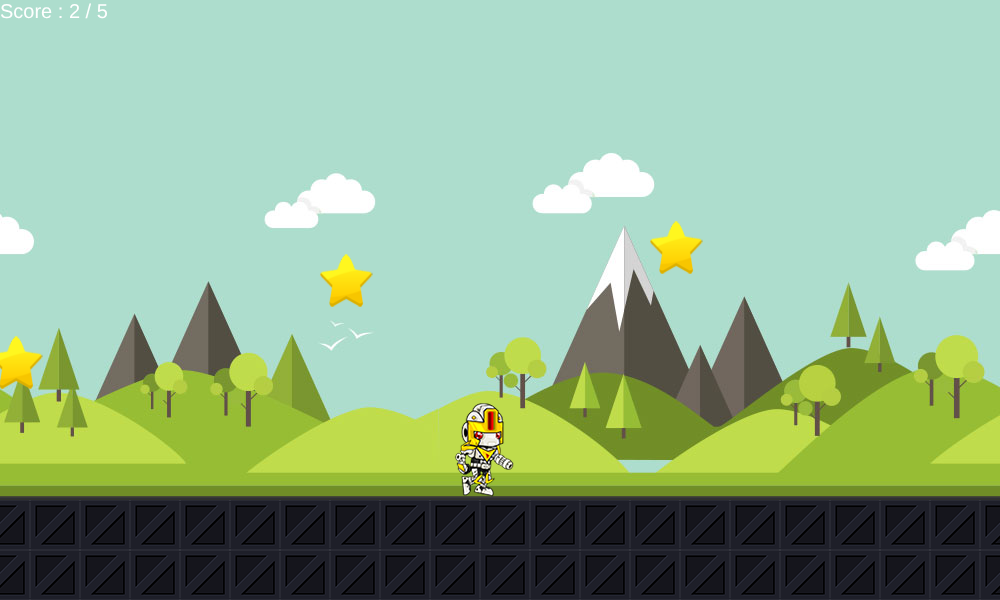

# CV – Robot Runner

Un petit jeu de course en JavaScript pour découvrir mon CV de façon ludique :
aide le robot à attraper **5 étoiles** et le CV s'affiche.



## Comment jouer

| Action | Ordinateur | Téléphone / tablette |
| --- | --- | --- |
| Lancer la partie | Bouton **Start** | Bouton **Start** ou toucher le jeu |
| Sauter | Flèche du haut ↑ ou barre **Espace** | Toucher le jeu |
| Mettre en pause | Bouton **Stop** | Bouton **Stop** |
| Recommencer | Bouton **Rejouer** | Bouton **Rejouer** |

Les étoiles arrivent sans arrêt jusqu'à ce que tu en aies attrapé 5.
Le CV s'affiche alors et la partie s'arrête.

## Lancer le jeu

Aucune installation n'est nécessaire : le jeu est en HTML, CSS et JavaScript, sans librairie.

- Ouvre `index.html` dans un navigateur, ou
- lance un petit serveur local depuis le dossier du projet :

  ```bash
  python3 -m http.server 8000
  ```

  puis va sur <http://localhost:8000>.

Le jeu peut aussi être publié tel quel sur GitHub Pages.

## Structure du projet

```
index.html   page du jeu (instructions, menu, zone de jeu)
style.css    mise en page et décor
robot.js     boucle du jeu : robot, saut, défilement, étoiles, score, victoire
pieces.js    les étoiles (création, déplacement, collision)
img/         décor, sol, robot, étoile, image du CV et capture d'écran
```

## Fonctionnement

- Une seule boucle de jeu (toutes les 60 ms) fait défiler le paysage et le sol,
  applique la gravité au robot et déplace les étoiles. Le bouton **Stop** met donc tout en pause.
- Le robot est animé avec une planche de sprites (`img/robot.png`) affichée à travers un cadre.
- La collision compare le rectangle de l'image affichée du robot avec celui de chaque étoile.
- Sur les petits écrans, la zone de jeu (1000 × 600 px) est réduite pour tenir dans la largeur.
